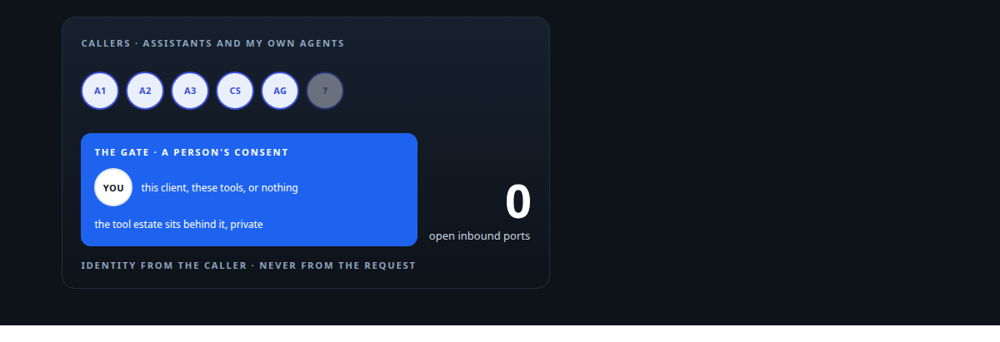
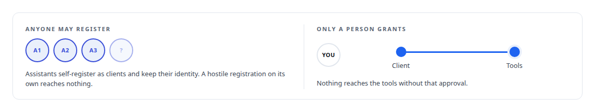
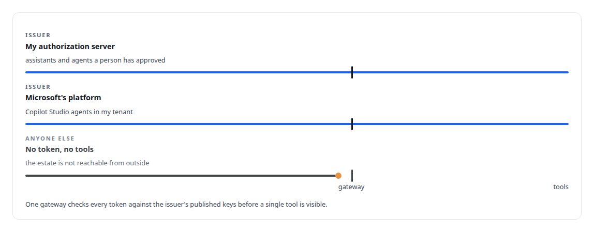
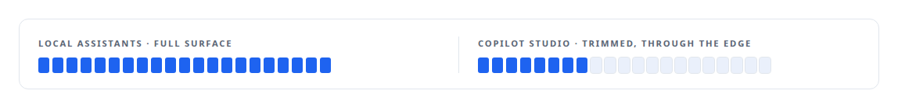
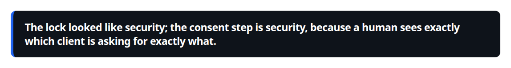

# Auth and access plane

**How commercial AI assistants and my own agents reach a private tool estate: OAuth, token validation, edge exposure and an operations layer**

Canonical: https://coreyjames.ai/systems/auth-and-access-plane/  
Author: Corey James · Published: 2026-10-28 · Kind: system  
DOI: https://doi.org/10.5281/zenodo.23735122  
Technologies: [ACME](https://github.com/coreyjames-ai/portfolio/tree/main/technologies/acme) · [Application security hardening and threat modelling](https://github.com/coreyjames-ai/portfolio/tree/main/technologies/application-security-hardening-and-threat-modelling) · [Applied cryptography](https://github.com/coreyjames-ai/portfolio/tree/main/technologies/applied-cryptography) · [C#](https://github.com/coreyjames-ai/portfolio/tree/main/technologies/c-sharp) · [Cloudflare Tunnel](https://github.com/coreyjames-ai/portfolio/tree/main/technologies/cloudflare-tunnel) · [Cloudflare Workers](https://github.com/coreyjames-ai/portfolio/tree/main/technologies/cloudflare-workers) · [Docker](https://github.com/coreyjames-ai/portfolio/tree/main/technologies/docker) · [Evidence-gated acceptance](https://github.com/coreyjames-ai/portfolio/tree/main/technologies/evidence-gated-acceptance) · [FastAPI](https://github.com/coreyjames-ai/portfolio/tree/main/technologies/fastapi) · [Grafana](https://github.com/coreyjames-ai/portfolio/tree/main/technologies/grafana) · [Identity and access management for AI agents](https://github.com/coreyjames-ai/portfolio/tree/main/technologies/identity-and-access-management-for-ai-agents) · [Independent verification and adversarial review](https://github.com/coreyjames-ai/portfolio/tree/main/technologies/independent-verification-and-adversarial-review) · [JSON Web Token (JWT)](https://github.com/coreyjames-ai/portfolio/tree/main/technologies/json-web-token-jwt) · [JavaScript](https://github.com/coreyjames-ai/portfolio/tree/main/technologies/javascript) · [Microsoft Azure](https://github.com/coreyjames-ai/portfolio/tree/main/technologies/microsoft-azure) · [Microsoft Copilot Studio](https://github.com/coreyjames-ai/portfolio/tree/main/technologies/microsoft-copilot-studio) · [Microsoft Entra ID](https://github.com/coreyjames-ai/portfolio/tree/main/technologies/microsoft-entra-id) · [Microsoft Teams](https://github.com/coreyjames-ai/portfolio/tree/main/technologies/microsoft-teams) · [Model Context Protocol (MCP)](https://github.com/coreyjames-ai/portfolio/tree/main/technologies/model-context-protocol-mcp) · [Multi-vendor LLM integration](https://github.com/coreyjames-ai/portfolio/tree/main/technologies/multi-vendor-llm-integration) · [NGINX](https://github.com/coreyjames-ai/portfolio/tree/main/technologies/nginx) · [OAuth 2.0](https://github.com/coreyjames-ai/portfolio/tree/main/technologies/oauth-2-0) · [Observability and alerting](https://github.com/coreyjames-ai/portfolio/tree/main/technologies/observability-and-alerting) · [Prometheus](https://github.com/coreyjames-ai/portfolio/tree/main/technologies/prometheus) · [Public environmental data APIs](https://github.com/coreyjames-ai/portfolio/tree/main/technologies/public-environmental-data-apis) · [Python](https://github.com/coreyjames-ai/portfolio/tree/main/technologies/python) · [React](https://github.com/coreyjames-ai/portfolio/tree/main/technologies/react) · [Redis](https://github.com/coreyjames-ai/portfolio/tree/main/technologies/redis) · [Site reliability engineering](https://github.com/coreyjames-ai/portfolio/tree/main/technologies/site-reliability-engineering) · [TLS and mTLS](https://github.com/coreyjames-ai/portfolio/tree/main/technologies/tls-and-mtls) · [TypeScript](https://github.com/coreyjames-ai/portfolio/tree/main/technologies/typescript) · [Vendor-integration reverse engineering](https://github.com/coreyjames-ai/portfolio/tree/main/technologies/vendor-integration-reverse-engineering) · [WebAuthn](https://github.com/coreyjames-ai/portfolio/tree/main/technologies/webauthn) · [Zero-inbound network exposure](https://github.com/coreyjames-ai/portfolio/tree/main/technologies/zero-inbound-network-exposure) · [ratatui](https://github.com/coreyjames-ai/portfolio/tree/main/technologies/ratatui) · [systemd](https://github.com/coreyjames-ai/portfolio/tree/main/technologies/systemd)  
Skills: [OAuth 2.0 and identity architecture](https://github.com/coreyjames-ai/portfolio/tree/main/skills/oauth-2-0-and-identity-architecture) · [zero-trust and zero-inbound networking](https://github.com/coreyjames-ai/portfolio/tree/main/skills/zero-trust-and-zero-inbound-networking) · [multi-agent governance](https://github.com/coreyjames-ai/portfolio/tree/main/skills/multi-agent-governance) · [tool synthesis and governed API integration](https://github.com/coreyjames-ai/portfolio/tree/main/skills/tool-synthesis-and-governed-api-integration)  



## Result

| Figure | What it measures |
| --- | --- |
| **1 person** | approves every grant on the consent screen |
| **21 → 8** | tools: the full local surface, and the trimmed one shown to Copilot Studio |
| **2** | token issuers the gateway accepts: my server and Microsoft's platform |

## What was built

My tool estate is private, and I wanted commercial AI assistants, including Microsoft Copilot Studio, to connect to it on my terms, alongside my own agents. The access plane is how they get in: an OAuth authorization server, gateway token validation against several issuers, an edge proxy that exposes a trimmed tool surface to a vendor's agent platform, and an operations layer that runs the estate.

## The idea

The consent screen is the control. Assistants self-register as OAuth clients, and a human approves each grant. A security review once found anonymous registration with attacker-chosen redirects, I locked registration down, and the next morning every assistant was locked out. I re-ran the threat model: a hostile registration gains nothing unless a human approves it on the consent screen. I reverted my own fix and wrote down why. See [The hardening fix that locked everyone out](https://coreyjames.ai/stories/the-hardening-fix-that-locked-everyone-out).



## What I built

An OAuth 2.0 authorization server with PKCE, published keys, dynamic client registration and consent-gated grants, fronted by NGINX with TLS and rate limits in a locked-down service unit.

Gateway token validation against published keys from several issuers, so the tool gateway accepts tokens from my server and from Microsoft's platform.



An edge proxy that exposes an authenticated, trimmed tool surface to Microsoft Copilot Studio without opening the estate behind it. Working out why the Copilot Studio connector stalled after initialisation, from the wire, was part of that.

A product-shaped weather MCP server as a worked example, later ported to .NET on the official MCP C# SDK.



An operations layer: a systemd service fleet, a documented Redis topology, tunnelled ingress and a private mesh with TLS termination, SMS alerting, runbooks and a status dashboard.

Cloud GPU bursting through the execution substrate's budget gate.

A larger set of hardening modules exists beside the server: device fingerprinting, rate limiting, request validation, tamper-evident audit, anomaly monitoring and hardware-key login, about 9,000 lines. The registration path runs only the consent gate and the NGINX front; it does not load those modules.

## The judgment in it

Consent over registration as the control point.



Reverting my own change the day after making it, because a system nobody can use while believing it is safer is the worse outcome.

Deferring a richer design, redirect allow-listing and client-class signals, rather than rushing it in under pressure.

## What it demonstrates

Security judgment under real use, identity engineering for AI clients, and working at a vendor's integration layer from wire evidence where the documentation runs out.

## Stories

[The hardening fix that locked everyone out](https://coreyjames.ai/stories/the-hardening-fix-that-locked-everyone-out)

## Technologies

OAuth 2.0 · PKCE · JWKS · WebAuthn · Python service · Edge worker runtime · NGINX · systemd · Redis · Tunnelled ingress · Microsoft Copilot Studio integration · .NET MCP SDK

> The lock looked like security; the consent step is security, because a human sees exactly which client is asking for exactly what.

## What was verified

Each line is a claim the canonical page supports, with the figure as the page states it.

- OAuth 2.0 and identity architecture: commercial AI assistants and my own agents admitted to a private tool estate as OAuth clients, with 1 person approving every grant on the consent screen.
- Delegated authorization for AI agents: one gateway that accepts tokens from 2 issuers, my own authorization server and Microsoft's platform, before any tool is visible.
- Microsoft Copilot Studio integration: an edge proxy that shows Copilot Studio a trimmed surface of 8 tools out of the 21 on the local surface, without opening the estate behind it.
- Zero-trust and zero-inbound networking: a private tool estate reached by commercial assistants with no open inbound ports.
- Security judgment under operational load: consent chosen over registration as the control point, and my own registration lock reverted the day after I added it.

## Related

- [The hardening fix that locked everyone out](https://github.com/coreyjames-ai/auth-and-access-plane/tree/main/stories/the-hardening-fix-that-locked-everyone-out) · https://coreyjames.ai/stories/the-hardening-fix-that-locked-everyone-out/

## Skills demonstrated

Decided at build time against every page in this system, strongest first; each links to the page that earns it.

- [OAuth 2.0 and identity architecture](https://github.com/coreyjames-ai/portfolio/tree/main/skills/oauth-2-0-and-identity-architecture) · [Auth and access plane](https://github.com/coreyjames-ai/auth-and-access-plane)
- [zero-trust and zero-inbound networking](https://github.com/coreyjames-ai/portfolio/tree/main/skills/zero-trust-and-zero-inbound-networking) · [Auth and access plane](https://github.com/coreyjames-ai/auth-and-access-plane)

## Engineering stories in Auth and access plane (1)

| Story | Result | Figure |
| --- | --- | --- |
| [The hardening fix that locked everyone out](stories/the-hardening-fix-that-locked-everyone-out) | Reversing my own security change within a day, because the threat model said a different control was the one that mattered | 3 |

Part of [Corey James's portfolio](https://github.com/coreyjames-ai/portfolio): research, technologies, skills and the other systems. Canonical site: https://coreyjames.ai/

## Citation

Corey James. "Auth and access plane." coreyjames.ai, 2026. https://coreyjames.ai/systems/auth-and-access-plane/ In: the Auth and access plane technical report, doi:10.5281/zenodo.23735122.

```bibtex
@misc{coreyjames-auth-and-access-plane,
  author = {Corey James},
  title = {Auth and access plane},
  year = {2026},
  howpublished = {\url{https://coreyjames.ai/systems/auth-and-access-plane/}},
  note = {GitHub copy: https://github.com/coreyjames-ai/auth-and-access-plane},
  doi = {10.5281/zenodo.23735122}
}
```

Part of [Auth and access plane](https://github.com/coreyjames-ai/auth-and-access-plane) and [Corey James's portfolio](https://github.com/coreyjames-ai/portfolio) · site: https://coreyjames.ai/ · MCP server: https://coreyjames.ai/mcp · agent card: https://coreyjames.ai/.well-known/agent.json
