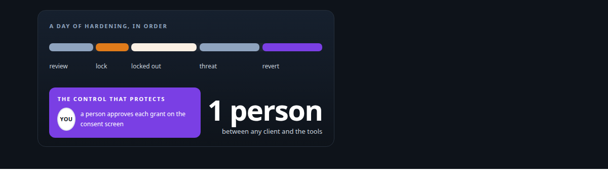
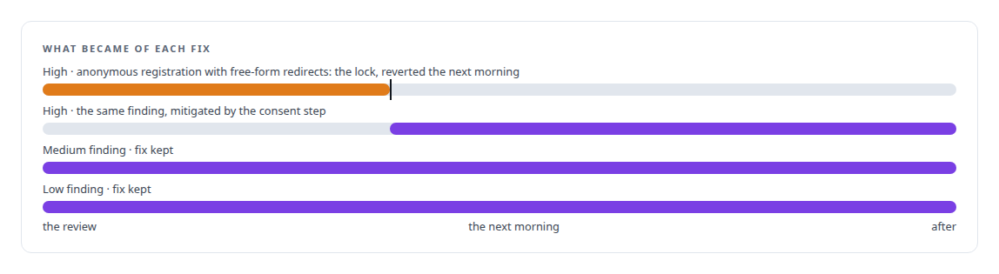
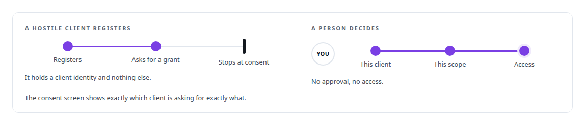
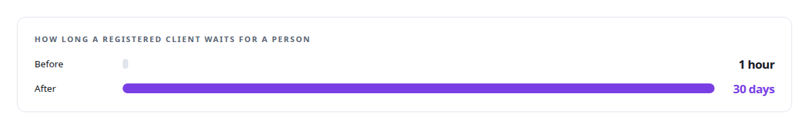

# The hardening fix that locked everyone out

**Reversing my own security change within a day, because the threat model said a different control was the one that mattered**

Canonical: https://coreyjames.ai/stories/the-hardening-fix-that-locked-everyone-out/  
Author: Corey James · Published: 2026-10-28 · Kind: story  
DOI: https://doi.org/10.5281/zenodo.23735122 (this page is a chapter of the system's report)  
Systems: [Auth and access plane](https://github.com/coreyjames-ai/auth-and-access-plane)  
Technologies: [Application security hardening and threat modelling](https://github.com/coreyjames-ai/portfolio/tree/main/technologies/application-security-hardening-and-threat-modelling) · [Evidence-gated acceptance](https://github.com/coreyjames-ai/portfolio/tree/main/technologies/evidence-gated-acceptance) · [FastAPI](https://github.com/coreyjames-ai/portfolio/tree/main/technologies/fastapi) · [Identity and access management for AI agents](https://github.com/coreyjames-ai/portfolio/tree/main/technologies/identity-and-access-management-for-ai-agents) · [JSON Web Token (JWT)](https://github.com/coreyjames-ai/portfolio/tree/main/technologies/json-web-token-jwt) · [Microsoft Copilot Studio](https://github.com/coreyjames-ai/portfolio/tree/main/technologies/microsoft-copilot-studio) · [Multi-vendor LLM integration](https://github.com/coreyjames-ai/portfolio/tree/main/technologies/multi-vendor-llm-integration) · [NGINX](https://github.com/coreyjames-ai/portfolio/tree/main/technologies/nginx) · [OAuth 2.0](https://github.com/coreyjames-ai/portfolio/tree/main/technologies/oauth-2-0) · [Python](https://github.com/coreyjames-ai/portfolio/tree/main/technologies/python) · [Redis](https://github.com/coreyjames-ai/portfolio/tree/main/technologies/redis) · [Site reliability engineering](https://github.com/coreyjames-ai/portfolio/tree/main/technologies/site-reliability-engineering) · [WebAuthn](https://github.com/coreyjames-ai/portfolio/tree/main/technologies/webauthn) · [systemd](https://github.com/coreyjames-ai/portfolio/tree/main/technologies/systemd)  
Skills: [OAuth 2.0 and identity architecture](https://github.com/coreyjames-ai/portfolio/tree/main/skills/oauth-2-0-and-identity-architecture) · [evidence-gated acceptance](https://github.com/coreyjames-ai/portfolio/tree/main/skills/evidence-gated-acceptance) · [AI-assisted engineering methodology](https://github.com/coreyjames-ai/portfolio/tree/main/skills/ai-assisted-engineering-methodology)  



## Result

| Figure | What it measures |
| --- | --- |
| **3** | holes the review found; the worst, anonymous registration with attacker-chosen redirects |
| **7** | acceptance probes, one or more for each fix |
| **24 h** | from adding the registration lock to reverting it |

## What was built

A security review of my deliberately public OAuth endpoint found holes, the worst of them in client registration. I fixed all three, checked the fixes with explicit probes, and the next morning every AI assistant that used the endpoint could no longer authenticate. I re-ran the threat model. The registration lock had added friction without adding security, because the control that protects is the consent screen, where I log in and approve every grant. I reverted my own fix and wrote down why.

## The challenge

The endpoint exists so that AI assistants, including commercial ones, can connect to my private tool estate. It has to be public, and the assistants self-register as OAuth clients, some of them caching their client identity indefinitely. I cannot hand a secret to every agent that might connect. The review was right that anonymous registration with free-form redirects is a textbook hole. The question was what closing it bought.



## Constraints

Public by design. Self-registering clients that remember their identity, so a lock that invalidates registrations breaks every existing client at once. One operator who cannot be a per-agent secret-distribution service.

## My approach

Severity-ordered triage, minimal fixes, explicit probes for each. Then, when the lock broke everything, the discipline to ask the question again from the top: what does an attacker gain from a hostile registration? Nothing, unless a human logs in and approves that client on the consent screen. 




## What I built

Admin-gated registration with fail-closed behaviour, plus two smaller fixes for the other findings.

Acceptance probes that checked each fix did what it claimed.

A one-line, reversible bypass of the registration gate, with the rationale written beside it, and the pending-client lifetime raised so legitimate clients stop expiring between uses.



## Difficult decisions

Reverting my own fix. It is uncomfortable to undo a security change the day after making it. It is worse to leave a system nobody can use while believing it is safer.

Choosing consent over registration as the control point. The lock looked like security. The consent step is security.

Not rushing a richer design. The right answer is more nuanced than either the lock or the bypass, and I did not force one in under pressure.

## Results

Every client can authenticate again.

## Technologies used

OAuth 2.0 · Dynamic client registration · PKCE · Python service · Redis · NGINX front with TLS and rate limits · Threat modelling

## What this demonstrates

Security judgment under real use: knowing which control protects, and reversing on evidence rather than defending a change because it was mine.

> The consent screen is the control. Registration is bookkeeping.

## What was verified

Each line is a claim the canonical page supports, with the figure as the page states it.

- Security incident judgment: I reverted my own registration lock within 24 h of adding it, after it locked every AI assistant out and the threat model showed consent was the control.
- OAuth 2.0 and identity architecture: a deliberately public endpoint where AI assistants self-register as clients and a person approves every grant on the consent screen.
- Security review triage: 3 findings fixed in severity order with minimal changes, each fix checked by acceptance probes, 7 in all.
- Threat modelling for AI client access: a hostile registration shown to gain nothing unless a person approves that client on the consent screen.

## Related

- [Agents with real tools and no keys](https://github.com/coreyjames-ai/fafohive/tree/main/stories/agents-with-real-tools-and-no-keys) · https://coreyjames.ai/stories/agents-with-real-tools-and-no-keys/

## Citation

Corey James. "The hardening fix that locked everyone out." coreyjames.ai, 2026. https://coreyjames.ai/stories/the-hardening-fix-that-locked-everyone-out/ In: the Auth and access plane technical report, doi:10.5281/zenodo.23735122.

```bibtex
@misc{coreyjames-the-hardening-fix-that-locked-everyone-out,
  author = {Corey James},
  title = {The hardening fix that locked everyone out},
  year = {2026},
  howpublished = {\url{https://coreyjames.ai/stories/the-hardening-fix-that-locked-everyone-out/}},
  note = {GitHub copy: https://github.com/coreyjames-ai/auth-and-access-plane/tree/main/stories/the-hardening-fix-that-locked-everyone-out},
  doi = {10.5281/zenodo.23735122}
}
```

Part of [Auth and access plane](https://github.com/coreyjames-ai/auth-and-access-plane) and [Corey James's portfolio](https://github.com/coreyjames-ai/portfolio) · site: https://coreyjames.ai/ · MCP server: https://coreyjames.ai/mcp · agent card: https://coreyjames.ai/.well-known/agent.json
